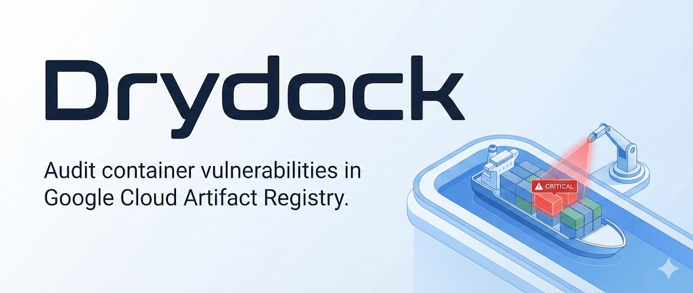

<div align="center">
  
</div>

# Drydock

**A lightweight CLI to audit container vulnerabilities in Google Cloud Artifact Registry.**

Drydock fetches vulnerability data directly from Google Cloud's Container Analysis API, allowing you to filter out noise and focus on High/Critical threats across your repositories.

## 🚀 Installation

### macOS & Linux (Recommended)

Run the following command to automatically download and install the latest binary.

**Default Installation (to `/usr/local/bin`):**

```bash
curl -sSfL https://raw.githubusercontent.com/hiro-o918/drydock/main/install.sh | sh
```

**Custom Installation Path:**
To install to a specific directory (e.g., local bin), set the `INSTALL_DIR` variable:

```bash
curl -sSfL https://raw.githubusercontent.com/hiro-o918/drydock/main/install.sh | INSTALL_DIR=$HOME/.local/bin sh
```

_(Make sure to add the target directory to your `$PATH`)_

### Go Install

If you have Go installed:

```bash
go install github.com/hiro-o918/drydock@latest
```

### Manual Download

You can also download the pre-built binary from the [Releases page](https://github.com/hiro-o918/drydock/releases).

## ⚡️ Usage

### Quick Start

Scan a location for **HIGH** and **CRITICAL** vulnerabilities.

```bash
drydock -p my-project-id -l us-central1
```

### Common Scenarios

**1. Find CRITICAL vulnerabilities only**
Focus on the most urgent threats.

```bash
drydock -p my-project-id -l us-central1 -s CRITICAL
```

**2. Find only fixable vulnerabilities**
Focus on vulnerabilities that have a fix available.

```bash
drydock -l us-central1 --fixable
```

**3. Find Medium+ severity vulnerabilities that are fixable**
Focus on actionable vulnerabilities of medium or higher severity that have fixes available.

```bash
drydock -l us-central1 -s MEDIUM --fixable
```

**4. Export report to CSV**
Generate a spreadsheet-compatible file for reporting.

```bash
drydock -p my-project-id -l us-central1 -o csv > report.csv
```

**3. Inference Project ID from Environment**
If you don't specify a project ID, Drydock will attempt to infer it from your environment (e.g., environment variables, service account credentials, or GCE metadata server).

```bash
drydock -l us-central1
```

**5. Scan the 3 most recently pushed digests per image**
Useful when a rollback window means older tags may still be running.

```bash
drydock -l us-central1 --latest 3
```

**6. Restrict discovery to specific repositories**
Only scan images under the given Artifact Registry repositories.

```bash
drydock -l us-central1 --repository prod --repository staging
```

**7. Scan a fixed, explicit set of images**
Bypass discovery entirely and scan exactly the given image references
(tag or digest). This is handy for pinning a CI job to the image it just
built.

```bash
drydock -l us-central1 \
  --digest us-central1-docker.pkg.dev/my-project/my-repo/my-image@sha256:e3b0c44298fc1c149afbf4c8996fb92427ae41e4649b934ca495991b7852b855
```

### Options

| Flag                    | Description                                                     | Default                 |
| :---------------------- | :-------------------------------------------------------------- | :---------------------- |
| `-l`, `--location`      | **(Required)** Artifact Registry location (e.g., `us-central1`) | -                       |
| `-p`, `--project`       | Google Cloud Project ID                                         | Active `gcloud` project |
| `-s`, `--min-severity`  | Filter by severity: `LOW`, `MEDIUM`, `HIGH`, `CRITICAL`         | `HIGH`                  |
| `-f`, `--fixable`       | Only show vulnerabilities that have a fix available             | `false`                 |
| `-o`, `--output-format` | Output format: `json`, `csv`, `tsv`                             | `json`                  |
| `-c`, `--concurrency`   | Number of concurrent API requests                               | `5`                     |
| `-d`, `--debug`         | Enable verbose logging                                          | `false`                 |
| `--latest`              | Number of most relevant digests to keep per image               | `1`                     |
| `--repository`          | Restrict discovery to this repository ID (repeatable)           | all repositories        |
| `--exclude-repository`  | Exclude this repository ID from discovery (repeatable)          | none                    |
| `--image-filter`        | Glob pattern restricting which image names are discovered (repeatable) | all images       |
| `--max-age`             | Exclude digests last updated more than this long ago (e.g. `720h`) | no limit             |
| `--digest`              | Explicit image reference to scan; bypasses discovery (repeatable) | -                      |

`--digest` takes precedence over `--latest`, `--repository`, `--exclude-repository`, `--image-filter` and `--max-age`: when set, discovery is skipped entirely and exactly the given images are scanned.

`--image-filter` patterns follow Go's [`path.Match`](https://pkg.go.dev/path#Match) glob syntax, where `*` does not cross a `/`.

## 🔑 Prerequisites

Ensure you have the following configured before running:

1.  **Authentication:** Run `gcloud auth application-default login` or set `GOOGLE_APPLICATION_CREDENTIALS`.
2.  **Permissions:** Your account needs:
    - `roles/artifactregistry.reader` (To list images)
    - `roles/containeranalysis.occurrences.viewer` (To read vulnerability data)

## 🛠 Using Drydock as a Library

Drydock can be used as a library in your Go applications, allowing you to implement custom exporters or integrate vulnerability scanning into your own tools.

### Basic Usage

```go
import "github.com/hiro-o918/drydock"

func main() {
    ctx := context.Background()

    // Initialize scanner with location and options
    scanner, err := drydock.NewScanner(
        ctx,
        "us-central1",
        drydock.WithProjectID("my-project-id"),
    )
    if err != nil {
        // Handle error
    }
    defer scanner.Close()

    // Run scan with HIGH severity threshold and only fixable vulnerabilities
    if err := scanner.Scan(ctx, schemas.SeverityHigh, true); err != nil {
        // Handle error
    }
}
```

### Custom Exporters

You can implement custom exporters by implementing the `Exporter` interface:

```go
type Exporter interface {
    Export(ctx context.Context, results []schemas.AnalyzeResult) error
}
```

Example of using a custom exporter:

```go
// Create your custom exporter
customExporter := NewMyCustomExporter()

// Use it with the scanner
scanner, err := drydock.NewScanner(ctx, "us-central1",
    drydock.WithExporter(customExporter))
```

For a complete working example of a Markdown exporter, see the [markdown_exporter example](./examples/markdown_exporter).

### Choosing Scan Targets

By default, `Scanner` discovers targets from Artifact Registry through a `LatestResolver`,
keeping one digest per image and preferring the `latest` tag when present. `LatestResolver`
can be tuned, or swapped out entirely for a custom `TargetResolver`:

```go
type TargetResolver interface {
    Resolve(ctx context.Context) ([]ImageTarget, error)
}
```

**Tuning the default discovery:**

```go
scanner, err := drydock.NewScanner(ctx, "us-central1",
    drydock.WithLatestResolverOptions(
        drydock.WithLatestCount(3),                      // keep the 3 most relevant digests per image
        drydock.WithRepositories("prod", "staging"),      // only scan these repositories
        drydock.WithMaxAge(30*24*time.Hour),              // ignore digests older than 30 days
    ),
)
```

**Scanning a fixed set of images with `StaticResolver`:**

```go
ref, err := drydock.ParseArtifactURI("us-central1-docker.pkg.dev/my-project/my-repo/my-image@sha256:...")
target := drydock.ImageTarget{Artifact: ref, Location: "us-central1"}

scanner, err := drydock.NewScanner(ctx, "us-central1",
    drydock.WithTargetResolver(drydock.NewStaticResolver(target)),
)
```

**Combining resolvers with `UnionResolver`:**

```go
imageResolver, err := drydock.NewImageResolver(ctx)
defer imageResolver.Close()
latest := drydock.NewLatestResolver(imageResolver, "my-project-id", "us-central1")
pinned := drydock.NewStaticResolver(target)

scanner, err := drydock.NewScanner(ctx, "us-central1",
    drydock.WithTargetResolver(drydock.NewUnionResolver(latest, pinned)),
)
```

`UnionResolver` merges the results of its resolvers and removes duplicate digests, keeping
the first occurrence in resolver order.

Note that `Scanner.Scan` fully resolves targets before analyzing any of them, since
deduplicating a `UnionResolver`'s combined results requires the whole set up front.

### Who closes what

`Scanner.Close` closes a resolver passed via `WithResolver`, and also closes a resolver
passed via `WithTargetResolver` if it implements `io.Closer` (as `LatestResolver` does),
without closing the same underlying `ImageResolver` twice. `UnionResolver` and
`StaticResolver` don't own or close the resolvers/clients they're built from, so when you
construct an `ImageResolver` yourself (as in the `UnionResolver` example above), you're
responsible for closing it.
